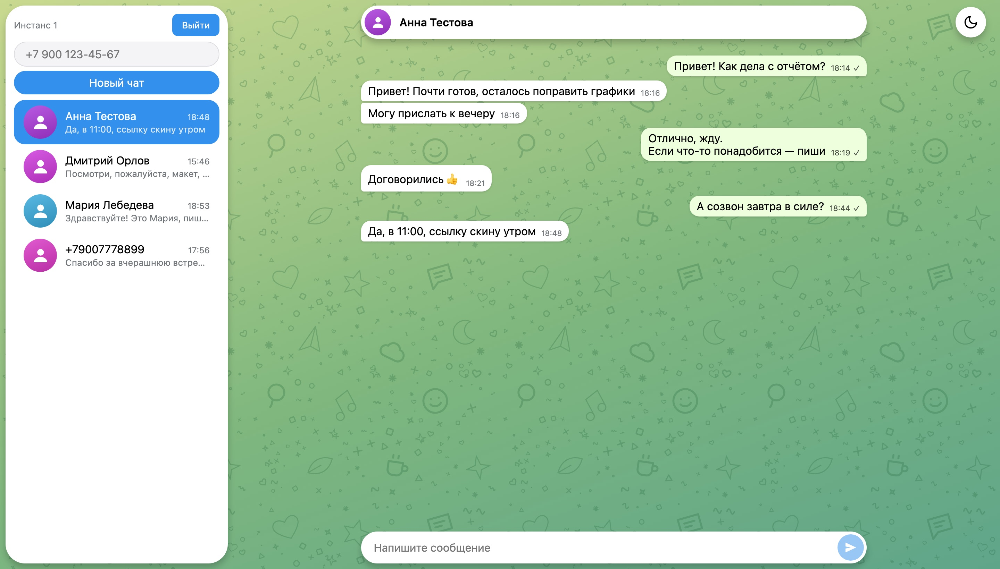
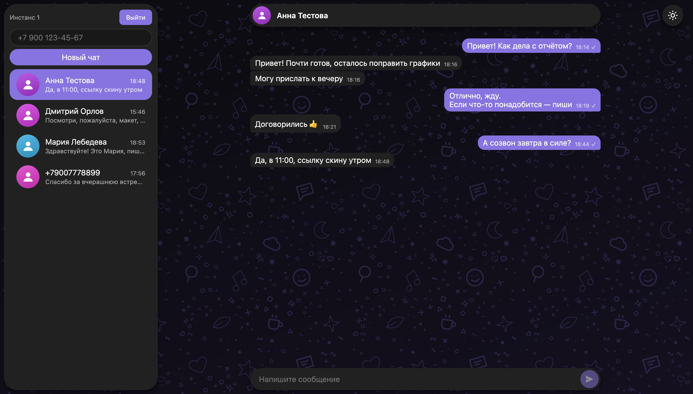
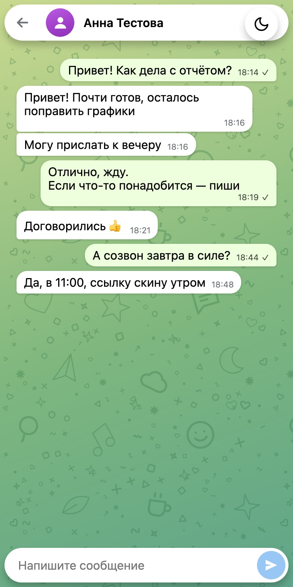

# messenger-web-client

Веб-клиент мессенджера на React: вход по данным инстанса GREEN-API, создание чата по номеру телефона,
отправка и получение текстовых сообщений. Работает с Telegram через GREEN-API (тестовое задание на React).




| Тёмная тема                                           | Телефон: переписка                                          | Телефон: список чатов                                    |
| ----------------------------------------------------- | ----------------------------------------------------------- | -------------------------------------------------------- |
|  |  |  |

Скриншоты сделаны на вымышленных данных.

**Демо:** `<ссылка появится после публикации>`

## Что умеет

- Вход по адресу API, `idInstance` и `apiTokenInstance`; перед входом проверяется состояние инстанса, при проблеме показывается
  понятное сообщение (не авторизован, запускается, заблокирован и т. д.). В поле адреса подставлен `https://api.green-api.com`,
  но у инстанса может быть свой адрес (например `https://4100.api.green-api.com`): его нужно взять в личном кабинете и ввести вместо стандартного.
- Новый чат по номеру: номер приводится к международному виду, `CheckAccount` проверяет, что на нём есть Telegram, и возвращает `chatId`.
  Внутри чат идентифицируется по `chatId` (на него приходят ответы, по нему хранится история). Название чата — имя собеседника:
  сразу после создания оно подгружается методом `GetContactInfo` (при сбое остаётся номер), а если имя не удалось получить, запоминается из первого входящего уведомления.
- Если первым пишет собеседник, которого не открывали по номеру, чат появляется в списке сам.
- Отправка текстового сообщения (`SendMessage`) со статусами «отправляется → отправлено / не отправлено»; многострочный ввод:
  Enter отправляет, Shift+Enter переносит строку.
- Получение ответов методами `ReceiveNotification` / `DeleteNotification` (long polling), только текстовые сообщения.
- Очередь уведомлений одна на инстанс, поэтому опрашивает её одна вкладка (замок Web Locks); вторая вкладка показывает плашку и
  подхватывает опрос, когда первую закроют.
- История чатов переживает перезагрузку страницы (`sessionStorage`) и стирается при «Выйти» и закрытии вкладки.
- Две темы (светлая и тёмная; по умолчанию системная, выбор запоминается), адаптивная вёрстка: на телефоне список чатов и переписка — два экрана.
- Автопрокрутка к новым сообщениям, а если пользователь читает историю, кнопка «вниз» вместо рывка списка.

## Запуск локально

Нужен Node.js 20.19+ (рекомендуется 24, см. `.nvmrc`).

```sh
npm install
npm run dev        # http://localhost:5173
npm test           # тесты (Vitest + Testing Library + MSW)
npm run lint       # oxlint
npm run build      # проверка типов и сборка в dist/
npm run preview    # посмотреть собранную версию
```

**Что нужно для проверки на живом инстансе**

1. Инстанс GREEN-API для Telegram (тариф Developer подходит), авторизованный в личном кабинете.
2. В настройках инстанса включены уведомления о входящих сообщениях (иначе очередь получения будет пустой).
3. Открыть приложение и ввести данные инстанса из личного кабинета: **адрес API** (у многих инстансов он персональный, вида
   `https://4100.api.green-api.com`; если в кабинете указан такой адрес, замените им стандартный), `idInstance` и `apiTokenInstance`.
4. Ввести номер получателя (например `+7 900 123-45-67`) и нажать «Новый чат».
5. Написать сообщение; ответ с другого аккаунта Telegram появится в чате.

Данные входа хранятся только в `sessionStorage` вкладки и уходят только на адрес API. В код, логи и тесты они не попадают.

## Быстрая проверка (5 минут)

1. Войти данными инстанса (адрес API из кабинета, `idInstance`, токен). Ошибочные данные дают понятное сообщение.
2. Ввести номер получателя и нажать «Новый чат»: чат появится в списке, через секунду вместо номера подставится имя.
3. Отправить сообщение: статус «отправляется → отправлено». Ответить с другого аккаунта Telegram: ответ появится в этом чате.
4. Написать на номер инстанса с аккаунта, которого в списке нет: чат создастся сам, активным не станет.
5. Обновить страницу (F5): чаты на месте. «Выйти»: чаты стёрты.
6. «Дублировать вкладку»: во второй вкладке плашка «открыто в другой вкладке»; закрыть первую — вторая подхватит опрос (работает на HTTPS и `localhost`, на обычном HTTP Web Locks недоступен).
7. Окно уже 768 px (или телефон): список и переписка — два экрана, кнопка «назад»; в длинной переписке при чтении истории появляется кнопка «вниз».

## Архитектура

```
src/
├── api/                  клиент GREEN-API (fetch), типы ответов, ошибки
├── features/
│   ├── login/            форма входа, хранение данных входа в sessionStorage
│   ├── chat/             всё про переписку (см. ниже)
│   └── theme/            хук useTheme и кнопка ThemeToggle
├── test/                 общий MSW-сервер и настройка тестов
├── App.tsx               вход или чат
└── index.css             стили: переменные тем, раскладка, адаптив
```

Внутри `features/chat/`:

| Файл                                                                  | Роль                                                                                                             |
| --------------------------------------------------------------------- | ---------------------------------------------------------------------------------------------------------------- |
| `chatReducer.ts`                                                      | чистый редьюсер: чаты, сообщения, жизненный цикл `sending → sent / failed`, дедупликация входящих по `idMessage` |
| `polling.ts`, `useNotifications.ts`                                   | цикл long polling и хук подписки (отмена при размонтировании, повторы с паузой)                                  |
| `usePollingLock.ts`                                                   | замок Web Locks: опрашивает очередь одна вкладка, остальные ждут и подхватывают                                  |
| `incoming.ts`                                                         | разбор уведомления в действие редьюсера (только текстовые сообщения)                                             |
| `chatStorage.ts`                                                      | сохранение и загрузка чатов в `sessionStorage` с проверкой формы данных                                          |
| `ChatApp.tsx`                                                         | корневой компонент чата: состояние, отправка, подключение опроса                                                 |
| `ChatList`, `MessageList`, `MessageComposer`, `NewChatForm`, `Avatar` | интерфейс                                                                                                        |
| `phone.ts`, `time.ts`, `localId.ts`, `avatarHue.ts`, `chatTitle.ts`   | небольшие чистые функции (`chatTitle`: имя → номер → `chatId`)                                                   |

**Поток данных.** Один `useReducer` на весь чат. Любое событие (отправка, ответ сервера, входящее уведомление, выбор чата) — это
действие `dispatch`, редьюсер возвращает новое состояние, интерфейс из него выводится. Запись в `sessionStorage` — эффект
после изменения состояния, сетевые вызовы живут в обработчиках и хуке опроса, а не в редьюсере.

**Получение сообщений.** `ReceiveNotification` (ожидание до 20 с) → обработка → `DeleteNotification`. Пустая очередь — сразу следующий запрос,
сбой сети — пауза 1, 2, 4… секунд (максимум 30). Ответ 401/403 останавливает опрос и показывает плашку «проверьте idInstance и токен».
Отмена опроса прерывает и сам запрос, и паузу.

**Решения, которые стоит знать**

- У сообщения два идентификатора: `key` (стабильный ключ списка React, не меняется за всё время жизни) и `idMessage` (от GREEN-API,
  появляется после ответа сервера). Благодаря этому элемент не пересоздаётся, когда исходящее сообщение получает `idMessage`.
- Повторное уведомление с тем же `idMessage` игнорируется (редьюсер возвращает то же состояние, перерисовки нет).
- Локальный id сообщения создаётся через `crypto.getRandomValues`, а не `crypto.randomUUID()`: последний недоступен на обычном HTTP-адресе.
- Темы: цвета лежат в CSS-переменных на `:root`, переключение меняет один атрибут `data-theme` на `<html>`.
- Раскладка телефона/десктопа выбирается CSS-медиазапросом, а не JS-флагом: нет подписок на `resize`, нет расхождений при поворотах.
- Опрашивает очередь одна вкладка: `usePollingLock` берёт именованный замок Web Locks на инстанс, остальные вкладки ждут за ним и подхватывают опрос,
  когда владелец закроется (браузер сам освобождает замок при закрытии вкладки). Без Web Locks (обычный HTTP не на `localhost`, старый браузер) защиты нет.
- Токен идёт в пути запроса, как требует GREEN-API, поэтому он не попадает ни в логи, ни в тексты ошибок.

## Допущения

- Внешний вид сделан по образцу веб-версии Telegram (простой чат: список слева, переписка справа).
- Тариф Developer позволяет обмен только с 3 чатами (при превышении сервис отвечает ошибкой 466, она показывается пользователю).
- Если первым пишет собеседник, которого не открывали по номеру, чат создаётся сам и появляется в списке (активным не становится).
  Название, как в Telegram: имя из уведомления (`senderName`), а если его нет — номер, иначе `chatId`. Имя запоминается и у чатов, созданных по номеру, при первом ответе. Номера в уведомлении может не быть, поэтому у такого
  чата он необязателен; если потом ввести номер этого собеседника, чат получит номер и не продублируется. Сообщения из групповых
  чатов (`@g.us`) пропускаются.
- Имя собеседника берётся из профиля (`GetContactInfo`: имя из телефонной книги инстанса, иначе имя профиля, иначе `@username`); если запрос не удался,
  название чата остаётся номером.
- Получение реализовано через HTTP API с long polling — этого требовали условия; для продакшена правильнее WebSocket или webhook.

## Ограничения и что можно улучшить

- **Одна очередь на инстанс:** уведомления опрашивает одна вкладка (замок Web Locks на инстанс), вторая показывает плашку и подхватывает опрос, когда первую закроют. У каждой вкладки своя история (`sessionStorage`), поэтому ответы видны только в вкладке-владельце. На обычном HTTP (не `localhost`) Web Locks недоступен и защиты нет.
- **Нет счётчика непрочитанных:** новый чат от собеседника просто появляется в списке.
- **Правки и удаления сообщений** не обрабатываются (нужны отдельные типы уведомлений и действие `messageEdited` в редьюсере).
- **Только текст:** фото, файлы и стикеры не поддерживаются и в чате не показываются.
- **Кнопка «Назад» браузера** на телефоне не возвращает к списку чатов (нет записи в историю; нужен роутер или `history.pushState`).
- **Плашка об остановке опроса** (401/403) показывается в переписке, поэтому на телефонном экране списка чатов её не видно.
- **Токен в браузере:** в продакшене запросы стоило бы пускать через собственный бэкенд-прокси, чтобы токен не жил на клиенте.
- **Большие переписки:** без виртуализации списка и `React.memo` рендерятся все сообщения чата; для сотен сообщений это стоит добавить.
- **Доступность:** базовая (подписи у кнопок и полей, скрытые подписи у статусов), полноценный аудит с клавиатурой и скринридером не проводился.

## Тесты

Vitest, Testing Library и MSW (запросы к API подменяются, реальная сеть не нужна). Проверяются клиент API, редьюсер, опрос (отмена, повторы,
остановка по 401/403), разбор уведомлений, хранилище, замок вкладок, компоненты и сценарии `ChatApp` целиком (создание чата, имя собеседника,
отправка, получение, чат от нового собеседника, дедупликация, возврат к списку на телефоне). GitHub Actions на каждый push запускает линт,
проверку форматирования, тесты и сборку.

## Стек

React 19, TypeScript, Vite, Vitest, Testing Library, MSW, Prettier, oxlint, GitHub Actions. Без UI-фреймворков и без внешнего state-менеджера.
